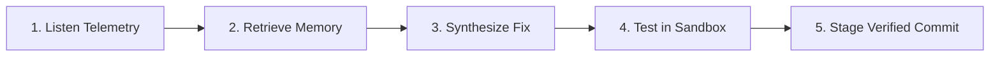

# 🧠 cipher-core — Autonomous Self-Healing State Machine

[](https://go.dev/)
[](#)
[](#)

The autonomous orchestration engine of the **Cipher AI PaaS**. It continuously monitors your local system for failures, searches your documentation for solutions, synthesizes fixes, tests them in an isolated sandbox, and stages verified git commits—completely autonomously.

---

### 💡 For Non-Techies: What does this do?
> Imagine you have an automated software doctor running inside your computer. When another program crashes or freezes:
> 1. **It spots the problem** immediately.
> 2. **It reads past incident notes** to see how similar problems were solved before.
> 3. **It drafts a fix** for the code.
> 4. **It tests the fix in a safe box** so it can't harm your computer.
> 5. **It saves the solution** once it is proven to work.
> 
> You don't need to install Python or Docker. It is a single, lightning-fast Go program that boots in under 10 milliseconds.

---

## The 5-Node Autonomous Remediation Pipeline



1. **`[Listen_Telemetry]`**: Intercepts incident metrics, container timeouts, and latency spikes from [`cipher-log`](https://github.com/sshloktiwarii/cipher-log).
2. **`[Retrieve_Context]`**: Queries [`cipher-mem`](https://github.com/sshloktiwarii/cipher-mem) vector memory for architecture decision records (ADRs) and past runbooks.
3. **`[Draft_Fix]`**: Dispatches context to [`cipher-route`](https://github.com/sshloktiwarii/cipher-route) to synthesize a minimal patch.
4. **`[Execute_Test]`**: Deploys candidate code directly to [`cipher-exec`](https://github.com/sshloktiwarii/cipher-exec) isolated sandbox (zero network, 3s process ceiling).
5. **`[Stage_Commit]`**: Upon test pass, queues a signed commit through [`cipher-mcp`](https://github.com/sshloktiwarii/cipher-mcp).

---

## Quickstart

### Build Standalone Binary
```bash
go build -o cipher-core .
```

### Run Single Remediation Loop
```bash
./cipher-core --once
```

### Run Continuous Supervisor Daemon
```bash
./cipher-core --poll-interval 2s --socket /tmp/cipher/core.sock
```

---

## License
MIT © [Shlok Tiwari](https://github.com/sshloktiwarii)
